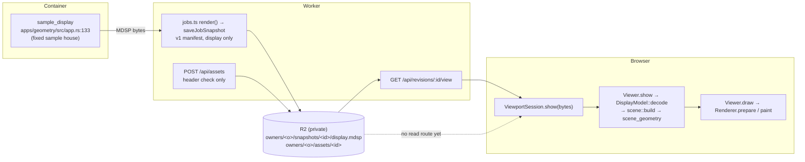
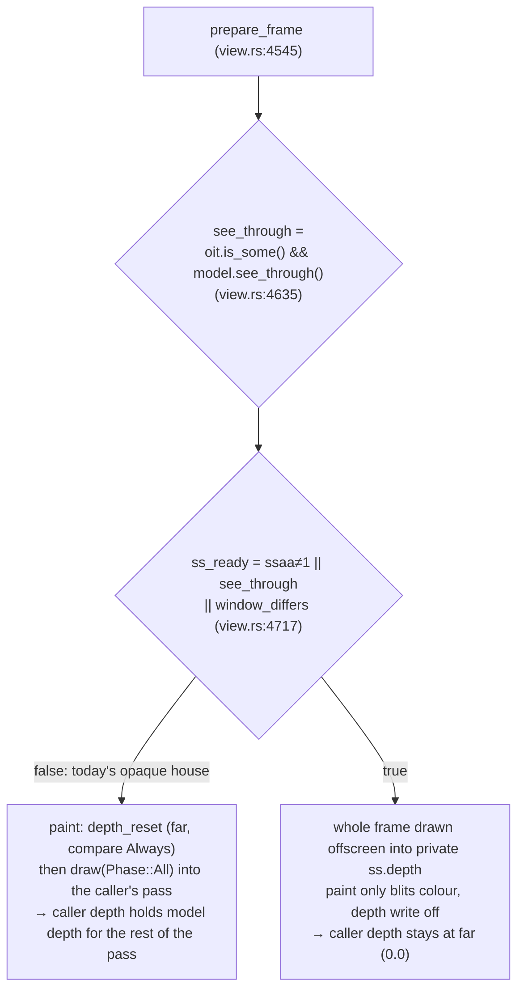

# How wood and tile patterns could be drawn in the madori viewer: architecture grounding for issue #173

Path shorthand used below:
- **ROOT** = `~/.t3/worktrees/instant-madori/t3-af5a7395-0ddbcf49ff5918de`
- **vgpu/** = `ROOT/third_party/solidcraft/crates/viewport-gpu/`

`crates/viewer/src/gpu.rs` line numbers are from HEAD. The worktree has uncommitted prototype edits that shift them (see "A prototype of A already exists").

## Overview

The browser 3D viewer is a wasm library, `ROOT/crates/viewer`. It decodes MDSP display bytes into a SolidCraft `Scene`, flattens that into a `GpuScene`, and has SolidCraft's `Renderer` (in viewport-gpu) draw it into a render pass the viewer opens. Today nothing in that path draws an image onto a model face:
- The triangle vertex format has no UVs.
- The only textured geometry in viewport-gpu is the reference-image quad (`GpuImage`). It is unlit, clamp-to-edge, uses fixed 0..1 UVs and has one mip level, so it cannot tile.
- WebGPU has no built-in way to make mips.
- Images users upload can be written to R2, but there is no route that reads them back, and nothing decodes them anywhere.
- The display format has room for an optional section, but no section is defined.
- Production still renders a hard-coded sample house.

So the work in #173 is a whole vertical slice: a material row in the housing data, the face frames at export, an MDSP section, an image-processing step, an asset read route, and a textured draw in the viewer.

The two rendering candidates differ in where the textured draw lives:
- **A:** a pipeline owned by `crates/viewer`, drawn into the same pass and depth buffer after `Renderer::paint`. It changes no upstream code. It only gets correct occlusion while viewport-gpu draws straight into the viewer's pass, and that stops the moment any body is see-through.
- **B:** a per-face base-colour map inside viewport-gpu's opaque shader. It gets depth, transparency and future lighting for free. It means carrying a local patch on a shared upstream crate that has strict rules (WebGL2-safe, FXC-safe, never crash) and a 7,698-line `view.rs` that changes often.

## Key concepts

- **`DisplayModel` / MDSP v1** (`ROOT/crates/display`): bodies with f32 positions and normals in mm (Z up), a B-rep face index per triangle (TFAC), and face colours (FCOL). Seven required sections in a fixed order. Optional sections are allowed only with flag 0, and `KNOWN_OPTIONAL_KINDS` is empty (`codec/v1.rs:12`). Decoding finishes by re-encoding and comparing bytes.
- **`Scene` → `GpuScene`**: `scene::scene` (`ROOT/crates/viewer/src/scene.rs:11-57`) builds `SceneMesh { color, face_colors, opacity = a/255, closed, values: None }`. `scene_geometry` (vgpu/`src/capture.rs:492-557`) expands every triangle into three standalone 32-byte vertex records.
- **Triangle vertex** (`TRI_SIZE = 32`, vgpu/`src/view.rs:36-45`): position f32×3, normal f32×3, palette index u32, analysis value u32. There is no spare word and no UV.
- **Palette**: RGBA entries indexed by `PaletteIndex`, uploaded as an `Rg32Uint` texture (the WebGL2-safe choice instead of a storage buffer). `intern` removes duplicates by RGBA (view.rs:178-189), so faces with the same colour share an index. `Material` (view.rs:94-119) is the existing precedent for "a per-entry table stored as texture rows".
- **Direct path and offscreen path**: `Renderer::paint` either draws the scene straight into the caller's pass, or blits a picture it drew offscreen. Which one runs decides whether the viewer's depth buffer holds model depth.
- **Reversed depth**: `Depth32Float` means near = 1 and far = 0. Use `depth_compare`, `far_depth` and `gpu_view_proj`, all `pub` in vgpu `view.rs:3279-3325`.
- **`FACE_BIAS`**: opaque faces are pushed away from the eye (view.rs:4114), so an unbiased coplanar draw with `LessEqual` (reversed to `GreaterEqual`) wins over them, the way decals do.
- **Planar frame**: `origin`, `u` and `v` axes with lengths equal to the repeat size, giving `uv = (dot(p−o, u/|u|²), dot(p−o, v/|v|²))`. Upstream's version is `PlanarFrame` in `solidcraft-render`, which the viewer may not depend on.

## How it works

### 1. Today's path from job to pixels

`Viewer::create` (gpu.rs:50-92) opens WebGPU with `downlevel_defaults().using_resolution(adapter)` and no optional features. It configures the browser's default canvas format, which is non-sRGB, plus a `Depth32Float` depth texture created `RENDER_ATTACHMENT` only (gpu.rs:282). It then creates a `Renderer` with `samples:1, oit:false, edges:false`. The `oit:false` does nothing: `GpuTarget.oit` is overwritten by the renderer (view.rs:3999).

`Viewer::draw` (gpu.rs:162-254):
1. Builds a `Frame` (gpu.rs:287-327) with `ssaa 1`, `ao_radius 0`, `sky` zero, `images` empty, `product_lights None`.
2. Calls `prepare`.
3. Opens one pass: colour Clear/Store; depth `Clear(0.0)` with `StoreOp::Discard` (gpu.rs:235).
4. Calls `paint`.

The viewer passes no edge lines and no grid, so it draws no edges.

### 2. Inside `Renderer::paint`: the depth question

**Verification (1): confirmed, with one nuance.**
- `oit::Pipelines::new` returns `None` only if an error scope pops with an error (vgpu `src/view/oit.rs:191-200`).
- In a browser the scope's answer is still `Pending` when `popped` polls it, and `popped` treats that as "no error" (vgpu `src/lib.rs:62-70`). So OIT is always `Some` in the browser.
- `Batches::see_through()` is true for any glass, trans, faded planned/instanced/block surface (view.rs:4320-4327). `scene_geometry` sends a mesh to `glass_tri` when its opacity is below `SEE_THROUGH = 0.999` (`viewport/src/scene.rs:68`).
- Therefore one body with alpha < 255 moves the whole frame offscreen.
- The blit pipelines use `window_depth`, which sets `depth_write_enabled: false` (view.rs:3443-3450). The viewer's depth then stays at the clear value, far.

The concrete failure for A is worse than "no occlusion". A pipeline testing `GreaterEqual` against far passes everywhere, so patterned faces paint over nearer walls.

The nuance is that this is latent today. Plan §3.5 says no window-glass or door-panel bodies are made (`ROOT/docs/plan.md:232`). Modeling writes alpha only from SolidCraft's `model_body_opacity` (`ROOT/crates/modeling/src/display.rs:86`), and nothing in housing or modeling sets opacity. The first see-through feature (glass panes, a faded storey, an x-ray view) or a move to `ssaa ≠ 1` would set it off. No public API turns OIT off.

Even on the direct path, three ordering rules apply to anything the viewer draws:
- Anything drawn before `paint` is wiped by `depth_reset` (view.rs:4751-4755).
- Depth is discarded when the pass ends.
- `paint` leaves its own pipeline and bind groups bound.

So A must record its draws into the same pass, after `paint`, and set all of its own state again.

### 3. What a textured face has to match: the shading model

Opaque faces use the pipeline `sc_tris`: `vs_tri` → `tri_vertex` (viewport.wgsl:139-165), then `fs_solid` → `solid()` (viewport.wgsl:460-479) → `lit_color` (viewport.wgsl:945-983). With `sky = 0` and no product lights, the old formula applies:
- key light = `normalize(back·0.8 + (−0.3, 0.2, 0.6))`, which follows the view
- `k = 0.42 + 0.38·diff + 0.25·fill − …`
- specular = `pow(n·h, 40)·0.25`
- output `min(base·k + spec, 1)`

This is computed directly on **sRGB-coded** colour bytes. `linear_out = t.format.is_srgb()` (view.rs:4073) is false for the browser canvas, so `out_color` passes values through unchanged.

So whichever candidate is chosen, the sampled texel must reach the formula sRGB-coded. Sampling `Rgba8UnormSrgb` (the hardware decodes before filtering, which is correct for averaging) and then encoding back to sRGB in the shader does that. The uncommitted prototype does exactly this.

There are two more shader constraints:
- World position already reaches the fragment shader as `TOut.wp` (location 2; viewport.wgsl:123-135), so a planar projection needs no vertex change.
- `textureSample` (and any derivative) must come before the `clipped()` discard. Browser WGSL compilers reject derivatives after a returning branch, and the test `derivatives_only_in_uniform_control_flow` (view.rs:6176-6247) counts `textureSample(` as a derivative.

### 4. Assigning pattern coordinates

There are two routes: compute the planar frame per face in the shader, or store per-vertex UVs in the display data.

**Verification (2): the mesher does not share vertices across B-rep faces.** The export calls `body.mesh()` (modeling `display.rs:44`), which runs `ModelBody::mesh` (`third_party/solidcraft/crates/doc/src/eval.rs:393`), then the reference mesh, then kernel `Body::mesh` → `mesh_of`, then `TessPlan::evaluate`. The doc comment on `TessPlan::evaluate` says: "vertices are shared within a face, not across faces, so creases keep their own normals" (`solidcore/crates/solidcore-tess/src/plan.rs:127-130`). Each face appends its own vertex range.

So a UV stored per position in MDSP is unambiguous for B-rep bodies, and no seam splitting is needed. The caveats:
- Mesh bodies (imported triangle meshes) supply their own triangles and could share vertices; madori creates none.
- `DisplayMesh::new` does not enforce the invariant. If UVs rely on it, the validator should check it.
- On the GPU the question doesn't arise: `scene_geometry` unpacks everything into unindexed records anyway (capture.rs:518-539).

How the two routes compare:

| | Planar frame in the shader (from `wp`) | Per-vertex UVs in MDSP |
|---|---|---|
| Display data | per-face record (map, repeat, orientation, origin), about 36–48 B per face | 8 B per vertex (POSN+NORM are 24 B) plus a per-face map id |
| Vertex format | unchanged | A: its own buffer, easy. B: widen `TRI_SIZE`, a large ripple (see §6) |
| Precision | `wp` is interpolated in f32. Fine for a house near the origin; housing allows coordinates up to 10⁷ mm (`housing/src/topology.rs:44`), where the f32 step is 1 mm and texels shimmer | UVs computed in f64 at export, relative to a nearby origin |
| Where frames are computed | export or the viewer | export |

The explorers disagreed on precision. Both are right within their own scope: f32 is fine for normal house sizes and degrades at the coordinate limit. At that limit, POSN itself is already f32 and the view matrix is already stressed, so the pattern is not the first thing to break. Keeping UV magnitudes small (an origin near the face) matters more than the route.

Upstream's ±128-repeat cap (`MAX_PLANAR_REPEAT`) is an admission rule in `solidcraft-render`, not a hardware limit. A hardware `Repeat` sampler doesn't care.

**Frame anchoring and wall edits.** Plan §6.4 requires the pattern scale to hold after a wall move, stretch or split.
- `House::move_wall` shifts the run perpendicular to itself, and the neighbouring walls stretch along their own axis.
- A frame anchored at a wall's start vertex (as `SideFrame` is, `modeling/src/model/side.rs`) slides on a stretched neighbour.
- A world-anchored frame does not change under these edits: along = `dot(p, u_wall)`, rise = z − storey base, floors in world XY.

These two points are explorer inference, not plan text. One further inference of mine, unverified: deriving `u = normalize(cross(Z, n))` from the face normal, rather than from the boundary's start→end direction, would also remove the sign flip a future split or merge could cause. Face → (wall, side) is already computable at export: `check_colors` in `modeling/src/model/paint.rs` matches faces to `SidePlan`s.

TFAC indices are per-artifact B-rep indices. Plan §3.5/§4.8 forbids storing them, so a face → frame table may live inside one MDSP but never in housing data.

### 5. Candidate A: a viewer-owned pipeline

**What it touches:** only `ROOT/crates/viewer`, plus web glue and an image route. The public helpers it can reuse are `SHADER`, `uniform_bytes` (view.rs:5552), `gpu_view_proj`, `reversed_depth`, `depth_compare`, `depth_bias`, `far_depth` and `FACE_BIAS`. The Renderer's uniform buffer, depth targets and bind groups are private. Reusing `lit_color` from `SHADER` would pull in the studio bindings 3-6, so copying the five-line formula is simpler.

**How it works:** draw after `paint` in the same pass, with `depth_compare(true, LessEqual)`, no depth write, unbiased. The patterned triangles win over viewport-gpu's biased copies of the same faces, as decals do. The cost is that every patterned face is drawn twice. Removing patterned faces from the `Scene` instead (and having A write depth) avoids the double draw, but makes glass ordering worse.

**Where A breaks:**
- **Any see-through body** (§2): the viewer's depth is empty and patterned faces show through walls.
- **Glass, even with a depth fix:** glass is composited inside `paint`, before A draws. Glass in front of a patterned floor would not tint it. Fixing this needs either viewport-gpu cooperation (write depth on blit, expose `ss.depth`, or a hook between the opaque and transparent phases) or A taking over glass as well.
- **Lighting:** shadows (§9) and AO never reach A's faces unless A copies or replaces them.

**A prototype of A already exists in this worktree, uncommitted and unreviewed:**
- `ROOT/crates/viewer/src/gpu/pattern_a.rs`, `pattern.wgsl`, `proto.rs`, `room.rs`, `ROOT/crates/viewer/proto/build.sh`
- features `pattern-proto` / `pattern-a` in `crates/viewer/Cargo.toml`, plus a refactor of `draw` into `render()` in `gpu.rs`

What it does:
- It has a `planar` mode (per-face uniform frame, one draw per face) and a `vertex-uv` mode.
- Textures are `Rgba8UnormSrgb` with CPU mips averaged in linear light.
- The sampler repeats, uses linear mip filtering and optional 16× anisotropy.
- It encodes sRGB again and applies the old lighting formula.
- The test room has toggles for `glass` (an opacity 0.35 pane, i.e. exactly the trap in §2), `start` (wall-anchored or world-anchored frames), `long` (a stretched wall) and `grid` (8 copies for load).
- It has a `bench` and a wasm size script.
- No results are recorded anywhere I looked.

### 6. Candidate B: per-face base-colour map inside viewport-gpu

The cheapest route **keeps every vertex format as it is**. Key a table of map frames (layer, origin, U, V, repeat) by **palette index**, and compute UVs from `wp` at the top of `solid()`. The palette index already reaches every opaque source: built vertices at location 2, planned bodies through `color_layout`, instanced bodies through each placement's u32.

What B touches:

1. **Shader** (`vgpu/shaders/viewport.wgsl`, 1,410 lines):
   - Add a flat palette index to `TOut` (123-135) and `FOut` (199-204).
   - Write it in `tri_vertex`, `vs_tri_inst` and `vs_tri_inst_flat`, and copy it in `flat_fragment`.
   - Sample before `clipped()`, then pass the sampled base colour into `lit`.
   - New bindings: a frame-table texture, a `texture_2d_array` (core WebGPU; 256 layers under downlevel limits) and a repeat sampler. Put them on group 0, or on group 3 of `solid_layout` (3597-3601). Group 3 is also used by the instanced-edges module; whether both can coexist was not checked.
2. **Rust** (`vgpu/src/view.rs`):
   - Add entries to `bgl` (3342-3379).
   - Fill all three group-0 bind-group creation sites: `PaletteGpu::new` (≈2091), the stand-in `bind` (≈3397) and `moving_bind` (≈3419).
   - Upload frame rows following the `material_texture` / `write_materials` pattern (1994-2040).
   - Upload the array and its mips.
   - Add a `GpuScene` field and its upload in `upload_scene` (2326).
   - Add a per-face map input on `SceneMesh` (`viewport/src/scene.rs`, another shared crate).
   - Change `scene_geometry` to give patterned faces **distinct** palette entries, because `intern` removes duplicates by RGBA. `Palette::with_stable` (view.rs:123) allows duplicates, and `MAX_PALETTE` is 2²⁰.
3. **Picked up automatically** through the shared `bgl` and `solid_layout`: `sc_tris*` (3786-3797), the cut pipelines, AO prepass, OIT, clouds, edges and product highlights. These only need valid bind groups.
4. **Cache keys:** if the maps travel in `GpuScene`, a new scene `key` covers them (upload on key change, view.rs:2294). If they travel in `Frame`, they must be hashed in `frame_key` (4440) and the test at view.rs:6114 extended.
5. **If B widened `TRI_SIZE` instead:**
   - `push_tri` and about 10 `GpuScene::*_tri` functions (1160-1253)
   - `BlockBuilder::triangle_words`, `InstancedMesh::expand_into`, `GroundAo::vertices_with_radius`, `sort_back_to_front`
   - 14 ui-egui files using the `TRI_*` constants
   - `tess.wgsl` would need to output UVs

   This is why the palette-index route is the realistic one.
6. **Tests to update:** `shader_is_valid` (5917), `the_uniform_matches_the_shader_layout` (6009) if `U` grows, and the frame-key test.

Upstream technical constraints that bind B (`ROOT/AGENTS.md` applies upstream's technical rules but not its process):
- WebGL2: no storage buffers in the main pipelines (per-entry data goes in textures), no `textureLoad` of depth, no texture level-count query.
- HLSL that FXC can compile.
- Derivatives only in uniform control flow.
- No unwrap/expect/panic/unsafe or input-derived indexing.
- The look users already have stays unchanged.
- Window and headless captures shade alike.

Service-side process:
- Every changed upstream file goes in `ROOT/third_party/solidcraft.json` `localPatches` (currently two `crates/io` files), or `ROOT/scripts/check/check-layout.ts` fails with "Unrecorded upstream change".
- The reason goes in the 独自変更 (local changes) section of `ROOT/third_party/solidcraft.md`.
- Upstream merges, local fixes and service changes are separate commits.
- Plan §4.2 (plan.md:436) already anticipates "4.8's additional implementation" and asks that a change to an existing crate keep the boundary, the reason and the dependent housing feature traceable.
- `view.rs` changes often, so expect subtree-merge conflicts there.

### 7. Display data plumbing (needed by both candidates)

- **New optional MDSP section:**
  - Add it to `KNOWN_OPTIONAL_KINDS` with flag 0. Flag 1 on a known optional section hits `UnknownFlags` in the current decoder.
  - Give it a typed field and setter on `DisplayModel`; today `extensions` is `pub(crate)` with no setter (`display/src/model.rs:190`).
  - Keep it canonical.
  - Old viewers keep the bytes and draw plain colour.
- FCOL's reserved byte can't carry a material id (`ReservedNotZero`).
- A format version bump breaks web and wasm together, because the web compares `content-type` exactly.
- **Encoder:** `Model::display()` / `display::export` know `EntryKind::{Wall{left,right}, Floor{room}}` and the `SidePlan`s. The housing data has only `wall_colors`. Floors have no appearance row, and there is no material row of the kind plan §3.3 describes (plan.md:210).
- **Manifest:** material and image references need a new snapshot version (plan.md:452), which means recreating the `snapshots` table under its CHECK constraint.
- **Production gap:** `render()` always calls `/v1/sample/display`. `Model::build`/`display` are behind no Container route, and v2 snapshots appear only in tests.

### 8. Images: where they are decoded, processed, stored and delivered

**Verification (3): plan §5.2** (plan.md:874, 878):
- The Worker can't shrink images and doesn't read EXIF orientation. It only checks headers: ≤ 2,576 px per side, ≤ 7,499,997 B.
- Decoded RGBA is at most about 26.5 MB (2576²×4), so it fits "wherever the pattern-making step (§4.8) runs". The plan deliberately leaves that location open.
- The decoding step must apply the same limits again while decoding.
- It must apply EXIF orientation, because uploads that bypass the UI can carry EXIF.
- The UI decodes with orientation applied, downsizes and re-encodes before upload, but the server does not trust that result.
- Stored width and height are pre-EXIF header values (plan.md:474).

So the decoder lives in the **Container** (Rust) or the **browser**, never the Worker. Related rules:
- §3.3: the reference image and the actual display material data are distinct.
- §4.8 (plan.md:723): materials add image loading, face coordinate assignment, real repeat size and orientation, and a display cache.
- §4.4 (plan.md:504): R2 is private; serve through the Worker or a short-lived URL after an ownership check.
- §4.3: the Container returns bytes and only the Worker writes R2.

| Decode site | Notes |
|---|---|
| Container | `image` is already in its graph. Needs a new internal route; the Worker passes the asset bytes in and stores the derived display texture (possibly with its mips) under a new key. One central place for the EXIF and limit checks. Mips add about 33% to the download. |
| Viewer wasm | `image` (png, hdr) is in the viewer's dependency graph through solidcraft-viewport, but the release wasm has zero functions from it. Decoding would add that code, and JPEG adds `zune-jpeg`. Runs on the main thread. §6.4 asks for the wasm size after materials; there is no budget or baseline file. Current shipped wasm is about 1.18 MB (≈240 KB brotli), dated before HEAD. |
| Browser-native | `createImageBitmap` → `Queue::copy_external_image_to_texture` exists under `cfg(web)` in wgpu 30.0.1. The destination colour space isn't forwarded (`webgpu.rs:680`, commented out), so "srgb" always applies. It `.unwrap()`s the JS call (`webgpu.rs:2823-2835`), so a browser exception (for example a cross-origin source) panics the wasm. Whether the browser applies EXIF by default was not verified here. |

The delivery route doesn't exist yet: an owner-checked GET for the display texture, then the web fetches it and hands it to the wasm. The prototype's `pattern_image(slot, w, h, rgba)` takes raw RGBA, i.e. it assumes decoding happens outside the wasm.

### 9. Mip generation

WebGPU has no generate-mipmaps call, and SolidCraft has no GPU mip pass. Existing mip code:
- `Environment` builds studio maps with a CPU 2×2 box filter and uploads them per level with `write_texture` (vgpu `src/environment.rs`).
- `solidcraft-render`'s `MipChain` (`texture_sampling/mips.rs`) is floor-halved, area-filtered in linear light, and handles odd sizes with integer overlap weights. Floor-halving gives exactly WebGPU's mip size sequence, so CPU levels map one-to-one onto `write_texture` levels. The viewer can't depend on render (`viewer-solidcraft` row, `ROOT/scripts/check/boundaries.ts:605-609`), and viewport-gpu can't either (layering). Reuse means copying the algorithm or moving it into a shared crate, and that is a policy call.
- The prototype uses a simpler uneven-bin box filter.

Options:
- CPU in the Container, stored with the texture.
- CPU in the wasm.
- A small GPU downsample pass in the viewer. `Rgba8UnormSrgb` is renderable and filterable, so hardware filtering averages in linear light.

Anisotropic filtering needs no feature (`anisotropy_clamp` maps to `maxAnisotropy`).

### 10. Sun shadows (plan §4.8 / §6.5)

Requirements (plan.md:725-727, §6.5):
- Sun direction from region, date and orientation.
- Occlusion by openings, walls, furniture, roofs and neighbouring houses.
- **Roofs hidden from display still occlude.** The set of shadow casters is not the set of drawn bodies.
- Glass passes light in the first version.
- Results are identified and cached by plan ID plus conditions, with stale results discarded.
- Shown on floors, walls and ceilings.
- Thin slits of light must not vanish.

viewport-gpu has no shadow map. `product_lights` kind 0 is a directional light without shadow. The ground shadow is ellipses built in banned `ui-egui`.

- **With A:** the viewer owns its geometry, so a light-space depth pass with any caster set (including hidden roofs) is easy. But it only shades the faces A draws. Shadowing faces viewport-gpu draws would need screen-space work against a depth buffer that is discarded, and empty on the offscreen path. If shadows must fall on every surface, A tends toward "the viewer draws all opaque geometry itself".
- **With B:** the AO prepass (`OpaquePipelines`, depth in `R32Uint`, in vgpu `src/view/ao.rs`) is a WebGL2-safe template for a depth pass from the light. It needs:
  - a light view-projection uniform and new `U`/`Frame` fields (every caller sets them: `capture.rs`, `msaa_check.rs`, the viewer)
  - the map bound next to the AO maps in group 2
  - the shadow term multiplied in at `lit(i, occlusion(i))`
  - a separate input for the caster set
- **Prototype with no upstream change:** `AccessMap::build(&meshes, sun_dir, v)` plus `analysis_uniform(Some(Access{dir}), …)` (view.rs:1419-1508) is already a CPU-built 1024² directional visibility test. It replaces all shading with two analysis colours (no texture), runs on the wasm main thread, and takes an explicit mesh list, so hidden roofs can be passed in.

### A vs B at a glance

| Concern | A (viewer pipeline) | B (in viewport-gpu) |
|---|---|---|
| Upstream patch | none | shared crate, `localPatches`, merge conflicts |
| Occlusion with see-through bodies | broken (§2) | correct |
| Glass in front of a pattern | wrong order | correct (OIT sees the base colour) |
| Shading parity | copy the formula; faces drawn twice | same `lit()` path |
| Future AO/sun on patterned faces | A must reimplement | one multiply in `lit` |
| Iteration speed and wasm-only change | high | lower (WebGL2/FXC/tests) |
| Coordinate route | either | planar from `wp` (no vertex change) |

## Where things live

| Path | What |
|---|---|
| `crates/viewer/src/gpu.rs` | `Viewer`: device, pass, `Frame`, `prepare`/`paint` |
| `crates/viewer/src/scene.rs` | `DisplayModel` → `Scene` → `GpuScene` |
| `crates/viewer/src/gpu/` | uncommitted A prototype |
| `third_party/solidcraft/crates/viewport-gpu/src/view.rs` | `Renderer`, palette, vertex format, pipelines, `frame_key` |
| `third_party/solidcraft/crates/viewport-gpu/src/capture.rs` | `scene_geometry` |
| `third_party/solidcraft/crates/viewport-gpu/shaders/viewport.wgsl` | `tri_vertex`, `solid`, `lit_color`, `fs_img` |
| `third_party/solidcraft/crates/viewport-gpu/src/view/oit.rs`, `src/view/ao.rs`, `src/lib.rs` | OIT, AO prepass (shadow template), `popped`/`depth_format` |
| `third_party/solidcraft/solidcore/crates/solidcore-tess/src/plan.rs` | `TessPlan::evaluate` (vertices per face) |
| `third_party/solidcraft/crates/render/src/texture_sampling/mips.rs`, `src/job/textures.rs` | `MipChain`, `PlanarFrame` (reference only; not a permitted dependency) |
| `crates/display/src/codec/v1.rs`, `src/model.rs` | MDSP sections, optional-section rules |
| `crates/modeling/src/display.rs`, `src/model.rs`, `src/model/side.rs`, `src/model/paint.rs` | export, face roles, side frames, face→side matching |
| `apps/worker/src/services/assets.ts`, `storage/assets.ts`, `storage/snapshots.ts` | upload, R2 keys, manifest versions |
| `scripts/check/boundaries.ts` (554-628), `check-layout.ts`, `check-viewer-wasm.ts` | viewer dependency rule, upstream patch check, wasm contents |
| `docs/plan.md` | §3.3 (210), §4.2 (426, 436), §4.3 (452, 474), §4.4 (504), §4.8 (711-727), §5.2 (874, 878), §6.4/§6.5 (1001-1032) |
| `third_party/solidcraft/assets/render/starter/materials/exports/` | MIT/Apache 512² wood maps at 240×480 mm (no tile maps) |

## Gotchas

- **Glass silently changes the render path for the whole frame.** It is latent today only because no see-through bodies are produced.
- **The `GpuTarget.oit` flag is ignored.** Passing `false` doesn't disable OIT.
- **Draws before `paint` are lost to `depth_reset`, and depth is discarded at the end of the pass.**
- **Colours are interned by RGBA.** A per-face lookup keyed by palette index needs distinct entries.
- **Lighting runs on sRGB-coded values.** Texels must arrive sRGB-coded, or plain and textured faces won't match.
- **`textureSample` must come before any discard or branch.** A test enforces this.
- **`GpuImage` can't tile:** clamp sampler, 0..1 UVs, one level, unlit.
- **`copy_external_image_to_texture` panics the wasm if the browser throws.**
- **The `Depth32Float` depth texture has no stencil,** so the viewer draws no section caps, only discards cut fragments.
- **No size budget exists for the viewer wasm,** and the shipped `pkg/madori_viewer_bg.wasm` may be stale compared with HEAD.

## Open questions

- Whether `oit::Pipelines::new` could actually fail on some browser. If it did, the renderer would hold invalid pipelines rather than `None`.
- Whether a `@group(3)` binding in `viewport.wgsl` clashes with the edges module's group 3.
- The cost of `AccessMap::build` for a whole house in wasm, and of PNG/JPEG decoding in the wasm.
- Whether browser `createImageBitmap` applies EXIF by default in every target browser.
- Whether copying `MipChain` into the service is acceptable under plan §4.2.
- What results the uncommitted prototype gives for `glass`, `start`, `mips` and `bench`. None are recorded.
- No material row schema, asset read route, MDSP material section or manifest version is specified yet.
