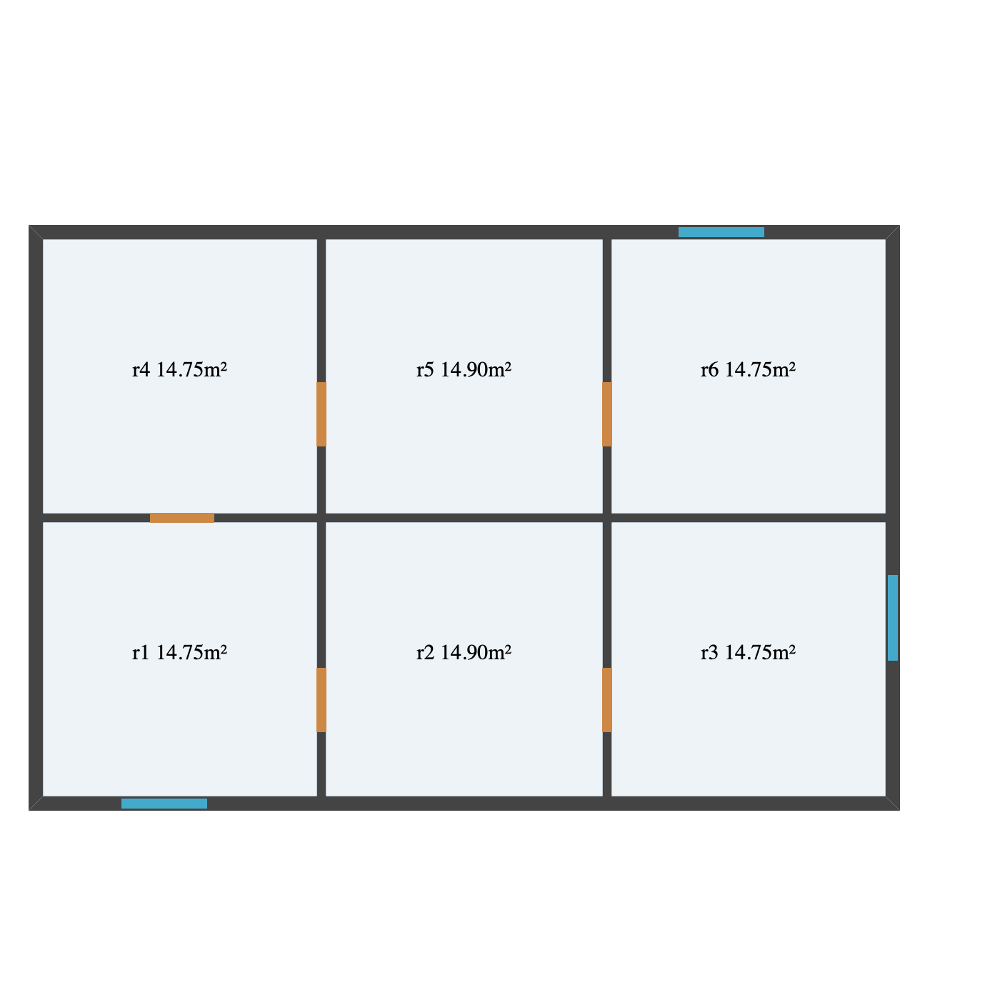
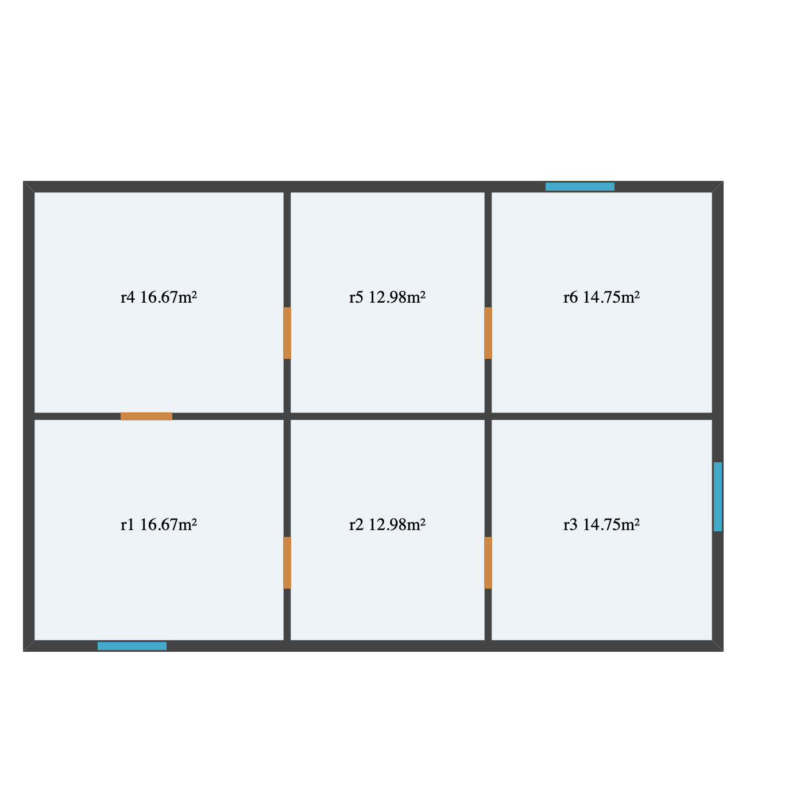
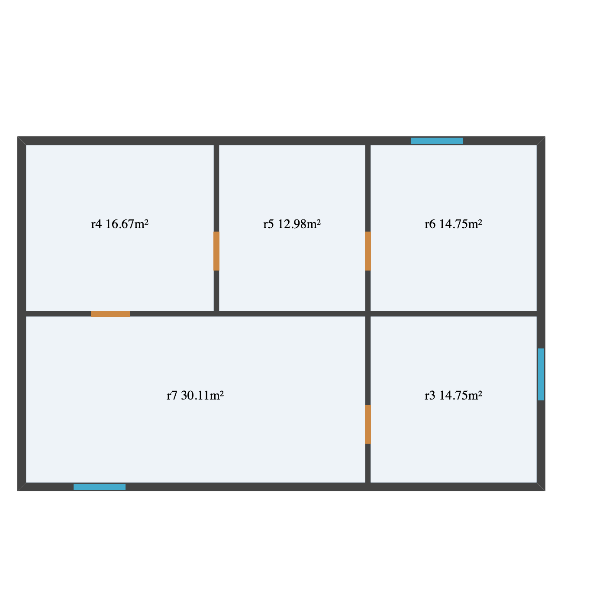

# 検証7：住宅データの持ち方（三つの試作の比較）

実施日：2026-11-19〜20。Issue #332。AIがSolidCraftで自由な3Dの加工と家具を作り、間取りを直した後も広さと2Dが3Dに追従する住宅を、どのデータで持つかを、三つの使い捨ての試作で比べた。案A（住宅データを正とし、AIの加工と物体を取り付け先の座標系で住宅データに持ち、要求ごとにすべて作り直す）を採った。実装計画への反映は #334 で行う。

## 対象と測り方

問いは「AIがSolidCraftで自由に3Dの形を作れて、しかも間取りと広さが追従する家を、どんなデータで持つか」である。副問は、正の置き場所、3Dの変更の表し方、間取りを直したときの引き継ぎの規則、広さと2Dの計算、保存の大きさと作り直しの時間、SolidCraftを変えずに済むか、AIに見せる操作の形の七つである。問いと場面の原文は [framing.md](evidence/verification-07/framing.md) にある。

家は[検証6の住宅入力](evidence/verification-06/house.json)（12,000×8,000 mm、6室の平屋）を使った。各案は、場面に要る分だけの住宅データを自分で定義した。

| 案 | 正 | AIの3Dの変更 | 間取りの変更 | 広さと2D | 前例 |
| --- | --- | --- | --- | --- | --- |
| A | 住宅データ | 取り付け先の座標系で書いた加工と、自分の座標系で書いた物体として住宅データに持つ | 住宅データを直し、毎回すべてを作り直す | 住宅データから | 検証6 |
| B | SolidCraftの文書 | 文書のフィーチャーとして直接足し、住宅の意味はラベルで持つ | 壁のフィーチャーの寸法を変える | 3Dから | なし |
| C | 両方を保存 | 文書のフィーチャーとして足し、住宅の部品との結びつきを持つ | 住宅データを直し、文書の寸法を変える | 住宅データから計算し、断面で照合する | 検証1 |

五つの場面は、どれももとの家から始める。

- S1 アーチ。v1-lowerにアーチ形の入口を作る（幅900、円弧の始まり1,800、上端2,250、壁に沿った位置2,500〜3,400）。仕切りを500 mm動かし、最後にv1-lowerを消す。アーチは壁の中の同じ位置についていき、壁と一緒に消える。
- S2 斜めの加工。northの上部を、東の端から2,000 mmの範囲で斜めに削る。東の外壁を600 mm外へ動かす。斜めの加工はnorthの東の端についていく。
- S3 色。v1-lowerのr1側の面を青にする。仕切りを動かし、その面にドアを足す。色は同じ面に残り、r2側には付かない。
- S4 階段。r4に直階段を置く（幅900、蹴上げ200×12段、踏面250）。段板に段鼻を付け、階段を600 mm動かす。段鼻は残る。
- S5 家具と造作。AIが椅子を作ってr1に置き、v1-upperのr4側に棚を作る。仕切りを動かし、v1-lowerを消す。棚は壁についていき、椅子は形も位置も変わらない。

どの段階でも、部屋の輪郭と広さが3Dと合うこと、評価の失敗がないこと、色の行方不明がないこと、立体が閉じていることを確かめた。各案は、壊れ方を探す試しも自分で加えた。案Aの負の対照N1〜N8と、案Bと案Cの試しX1〜X5である。

試作はRust 1.99.1のdevプロファイルで、依存だけをopt-level 2でビルドした。Mac16,11、macOS 27.2.1、論理CPU12、メモリ24 GiBである。時間は各段階で一回だけ測った値で、ベンチマークとしての精度はない。最初の実行の基準は `5188e405013d3d7df1035d3d9d6e65eecd7886b6`、再実行の基準は `4ce035305d8a66d4504e7de93cac6be927e71460` である。後者はSolidCraftのupstream `7c0f565e9` を含む。

各案は、担当の案だけを作る試作役（Claude Opus）が実装した。採点は三案を見比べた一人が行い、他系統のモデルの判定役は立てなかった。

## 結果

| | A 住宅データが正 | B 文書が正 | C 両方を保存 |
| --- | --- | --- | --- |
| 五つの場面 | すべて合格（15段階と追加のS3.4） | すべて合格（15段階。もとの家の記録S0は数えない） | すべて合格（15段階） |
| 危ない操作 | N1〜N8をすべて検出または拒否（取り込みの後、N1は広さが追従して確定する） | X1とX5が報告なしに通った。X4の宙に浮いた壁の端は検出できない。X2cはReselectで失敗 | X3とX4が報告なしに通った |
| 保存するもの | 住宅データのJSON、1,818〜4,322 B | 文書、26,057〜60,285 B | 両方と対応表、7,659〜15,492 B。文書を作り直せないので増え続ける |
| 作り直し | 60〜342 ms | 49〜137 ms | 読込54〜143 ms、操作は最大805 ms |
| AIの操作 | 9種類。住宅の決まりはCADを呼ぶ前に検査する | SolidCraftのコマンドをそのまま使う。決まりは評価の後にしか検査できない | 住宅の操作とSolidCraftのコマンドの組 |
| 採点（R1〜R6） | 5・4・4・4・4・5 | 4・3・3・2・4・5 | 4・3・2・3・3・5 |

保存の大きさと時間は、`results/5188e4050/` の記録の値である。時間は一回だけ測った値なので、試作役の報告（`notes/`）にある値とは実行ごとに違う。

採点の基準は、R1 場面の正しさ、R2 追従と健全さ、R3 規則の少なさ、R4 AIの操作の形、R5 保存と作り直し、R6 SolidCraftを変えずに済むか、である。

三案は広さを別々に計算し、同じ値になった。r1は仕切りの移動で14.7456 m²から16.6656 m²になり、統合した部屋は30.1056 m²、S2の後のr3とr6は17.0496 m²である。

案Aの2Dの図を、もとの家、仕切りを500 mm動かした後（S1.2）、v1-lowerを消した後（S1.3）の順に示す。図は部屋、壁、開口、広さだけを描き、加工と家具は描かない。





## 決め手

案Aでは、アーチは仕切りを動かすとy=2,500〜3,400のままx=4,500へついていき、壁を消すとドアと色と一緒に消えた。斜めの加工は東の端についていった。S3.4では、色を塗った面を溝で本当に4つに分けたが、4つとも青のままだった（5,464,800 mm²）。棚は壁と一緒に500 mm動き、椅子は形も位置も変わらなかった。同じ住宅データから、バイト単位で同じCADの文書と表示データができた。面の名前や番号を保存しないので、参照先が消えて失敗すること（Reselect）が原理的に起きない。

案Bでは、絶対座標で書いた棚が、壁が動いても500 mm置き去りになり、何も報告されなかった（X1）。壁の上に面一の梁を足すと、青が7,371,000 mm²から8,523,000 mm²に黙って広がった（X5）。ドアを消すと、別の加工が参照していた縁が合わさり、Reselectで失敗した（X2c）。住宅の決まりは評価の後にしか検査できず、壁の接合を表すラベルもない（X4）。

案Cでは、住宅データがAIの作った形を知らないので、ドアをアーチに重ねる移動を黙って受け付けた（X4）。絶対座標で書いた加工は、壁が動いても黙って追従しなかった（X3）。面の名前にフィーチャーの番号（`F<id>`）が入るので文書を作り直せず、壁の接合を書き直す処理も作れていない。

案Bと案Cの試作役も、報告の「取り込みたい改良」で、AIの加工を取り付け先の座標系で書く案Aの考え方を挙げた。

## 採った持ち方（案A）

試作の形であり、本番の型は6.2のIssueで決める。

- 住宅データは、安定したIDをキーにした型付きの記録で持つ。節点、壁（節点2つと厚さ）、部屋（反時計回りの境界の列）、開口（壁の始点からの距離）、壁と側ごとの色、階段、加工、物体である。
- 加工は、取り付け先（壁か、階段の各段板）と、取り付け先の座標系で書いたスケッチのコマンドと、切り取りか足し合わせかを持つ。壁の座標系は、基準の端（始点か終点）からの壁に沿った距離と高さである。作り直すときは、取り付け先の平面にスケッチを置くので、コマンドの座標は書き換えない。押し出しの深さと対象（取り付け先のボディだけ）は作り直す側が決める。
- 物体は、自分の座標系で書いたコマンドの列と置き場所を持つ。部屋に置くなら平面上の位置と向きで、所属する部屋は改訂ごとに求め直す。壁に付けるなら壁・側・壁に沿った位置・高さである。家を作る前に原点で組み立て、置き場所へ動かす。
- 保存するのは住宅データのJSONだけで、SolidCraftの文書は保存しない。
- 改訂は、写し、住宅の決まりの検査、作り直し、3Dの検査、採用の順に進める。どこかで失敗したら、前の住宅データを残す。
- 部屋の輪郭を変える加工がある部屋は、壁の投影から広さを求める（次の節）。

引き継ぎの規則は八つで、特別扱いは6と7の二つである。

1. 開口と加工は取り付け先の座標系で持ち、取り付け先が動いても伸びても、基準の端についていく。
2. 取り付け先を消すと、その開口、加工、色を一緒に消し、消したものを操作の結果で返す。
3. 色は壁と側の組で持ち、作り直すたびに、開口と加工を避けた点で塗り直す。分かれた面もすべて塗る。
4. 壁に付けた物体は、壁の基準点、側、高さについていく。
5. 部屋に置いた物体は位置を保ち、所属する部屋を改訂ごとに求め直す。
6. 壁に付けた物体の壁を消すと、その時点の位置のまま、部屋に置いた物体へ変える。
7. 壁を消して二つの部屋をつなぐと、境界の列をつないだ新しいIDの部屋にする。
8. 壁を動かすと、その壁の上の節点も動き、T字でつながる壁が伸び縮みする。

AIの操作は、場面に要った9種類だった（`addWallModifier`、`addStairModifier`、`moveWalls`、`deleteWall`、`paintWallSide`、`addOpening`、`addStair`、`moveStair`、`addObject`）。部屋の配置から家を作る操作など、場面に出なかった操作は比べていない。

## 投影による広さ（案Bからの取り込み）

三案を比べた後、案Aに案Bの方法を足した。別のSessionで、すべての壁のボディを床（z=0）へ投影し、部屋の内点の下の領域の面積を測る。部屋の輪郭を変える加工（部屋側へ足し合わせる加工）がある部屋は、この面積を広さにする（`--area-policy=follow-projection`、既定）。もとの「検出して拒否する」動きは、`--area-policy=refuse` で残した。

- 輪郭を変える加工のない部屋では、投影の面積は住宅データの面積と一致した。100の部屋と段階の組で、最大のずれは3.7e-9 mm²（S2.2のr6）だった。
- S2の後のr6は、高さ2,350 mmの断面では閉じなかったが、投影では閉じた。S2.1で14,745,600 mm²、S2.2で17,049,600 mm²である。
- N1（v1-lowerを両側へ20 mm、長さ600 mmにわたって膨らませる加工）は、追従の設定で確定された。r1は14,745,600 mm²から14,733,600 mm²に、r2は14,899,200 mm²から14,887,200 mm²になり、ちょうど600×20 mm²ずつ減った。高さ2,350 mmの断面とのずれは0だった。拒否の設定では、これまでどおり拒否した。
- 弱点が一つあった。N3（全高の切り欠きで壁を二つに分ける）では、分かれた側のボディ（`v1-lower (1)`）が投影から漏れ、r1とr2を一つの領域として測った（29,968,800 mm²）。漏れた面積は、2,400×120と300×120の和でちょうど説明できる。N3は対応のない立体の検査で拒否されるので、確定はされない。本番では、すべての壁のボディを投影するか、対応のない立体を先に拒む。
- 確かめていないことが二つある。壁の端を越えて隣の部屋へ伸びる足し合わせは、輪郭を変える加工として検出しない。片面に限った足し合わせは、試作のスケッチの置き方のために部屋側へ10 mm出る。

## 今のmainでの再実行

`4ce035305` で三案をビルドし直し、実行した。記録ごとの合否の比較は [results/comparison.tsv](evidence/verification-07/results/comparison.tsv) にある。

| 案 | 記録の数（5188e4050 → 4ce035305） | 合否が同じ記録 | 違う記録と理由 |
| --- | --- | --- | --- |
| A | 26 → 27 | 26 | なし。追従の設定で実行したN1が1件増えた（取り込みによる） |
| B | 25 → 25 | 25 | なし |
| C | 26 → 26 | 26 | なし |

案Aは、取り込みを足したコードで実行した。framingの15段階とS3.4は合格し、N2〜N8はすべて検出され、同じ住宅データからバイト単位で同じ結果ができた。拒否の設定でも同じ合否になった。

合否は変わらなかったが、時間を除く次の値が変わった。部屋の輪郭と広さ、立体の体積、色が付いた面は、三案とも変わっていない。

- 色を塗った面の代表点として書き出す座標が変わった。案Aで100、案Bで142、案Cで7の値である。SolidCraftの更新で、面から選ぶ点が変わった。
- SolidCraftの文書のJSONが、一つの記録あたり215〜228 B大きくなった（案Aの `cadDocBytes` と、案Cの `savedBreakdown.solidcraftDocPretty`）。文書を保存する案Bと案Cでは、保存量も増えた。案Bは全25件で228 B、案Cは全26件で173〜186 Bである。
- 表示データが小さくなった。案Aで18,144〜27,856 B、案Cで16,688〜55,856 B減った。たとえば案CのS1.1は、37,848 Bから19,368 Bになった。
- 案Cで、寸法を変えたときに計算し直したフィーチャーの数（`propagation.recomputed`）が、6つの記録で減った。たとえばS1.2では15から6になった。
- 案AのN2で、SolidCraftが「切り取りが材料を取り除かない」という警告を新しく出した。加工が取り付け先を変えなかったという案A自身の検出は、前と同じである。
- 案AのN1とN3で、取り込みで足した投影の照合のメッセージが増えた。記録には `policy` などの項目も増えた。
- 説明の文に埋め込んだ数値（`reason`）が、浮動小数点の末尾の桁で変わった。

## 残る課題

- 加工の基準の端。AIが壁の向きを知り、始点と終点のどちらを基準にするかを選ぶ必要がある。サービスが「東の端から」のような指定を受け取れれば、この負担はなくなる。
- 点で選ぶ加工（面取り、丸め、shell）。点を取り付け先の座標系で持つ案は、試していない。
- 接合の規則。試作はT字と2本の角だけを扱った。本番では検証6の規則を使う。
- 段板ごとの加工で、作り直しが78 msから351 msに増えた。待ち時間は数分まで許されるので、今は問題にしない。
- 投影による広さの弱点。分かれた壁のボディを投影に含めること、壁の端を越える足し合わせを輪郭を変える加工として見つけることは、本番で確かめる。

## 再実行と証拠

証拠は [evidence/verification-07/](evidence/verification-07/) にある。

- `Cargo.toml` と `Cargo.lock` は、三案をまとめたワークスペースである。依存はリポジトリの `crates/modeling`、`crates/display`、SolidCraftの `doc` と `engine` を相対パスで指す。
- `candidate-a/`、`candidate-b/`、`candidate-c/` は三案のコードである。案Aは取り込みを足した後のコードで、`--area-policy=refuse` を付けると取り込み前と同じ判定になる。案Cは、作業場所の絶対パスの定数だけを、自分の場所から求める形に直した。
- `fixtures/house.json` は、検証6の住宅入力の写しで、内容は同じである。
- `results/5188e4050/` と `results/4ce035305/` に、案ごとの `steps.jsonl` と実行のログがある。`results/comparison.tsv` は、記録ごとの合否の比較である。案Aの `results/4ce035305/` には、追従の設定（`steps.jsonl`）と拒否の設定（`steps-refuse.jsonl`）の両方がある。
- `notes/` に、各案の試作役の報告がある。ファイルの置き場所の記述は、試作の作業場所での名前のままである。
- `source-hashes.txt` は、上のファイルのSHA-256である。`shasum -a 256 -c source-hashes.txt` で確かめられる。

証拠のフォルダーは、基準のコミットには入っていない。再実行するときは、基準のコミットのworktreeを作り、この記録を含むコミット（mainなど）から証拠のフォルダーを写して実行する。

```sh
git worktree add --detach ../v07-rerun 4ce035305d8a66d4504e7de93cac6be927e71460
cd ../v07-rerun
git checkout origin/main -- docs/verification/evidence/verification-07
cd docs/verification/evidence/verification-07
cargo run -p candidate-a
cargo run -p candidate-a -- --area-policy=refuse
cargo run -p candidate-b
cargo run -p candidate-c
```

二つ目のコマンドは、案Aの取り込み前の判定を出す。結果は同じ場所の `reports/` に書き出され、Gitの追跡対象にならない。`4ce035305` の作業ツリーでこの証拠の写しから実行し直し、三案とも `results/4ce035305/` と同じ合否になることを確かめた。SolidCraftを一からビルドすると、`target/` は10 GBを超える。
