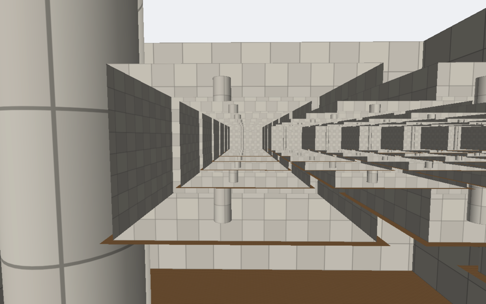
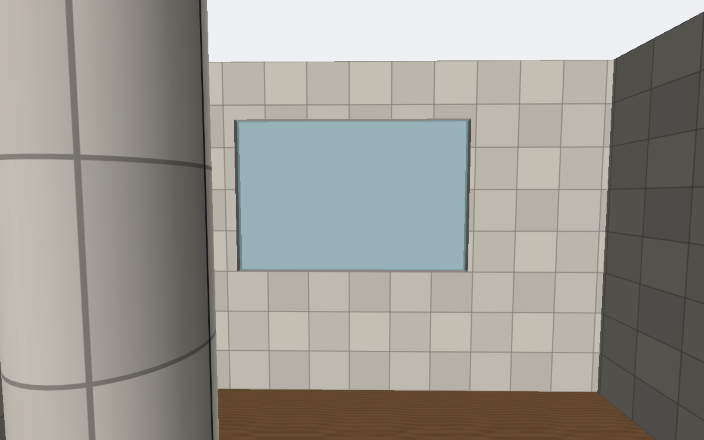
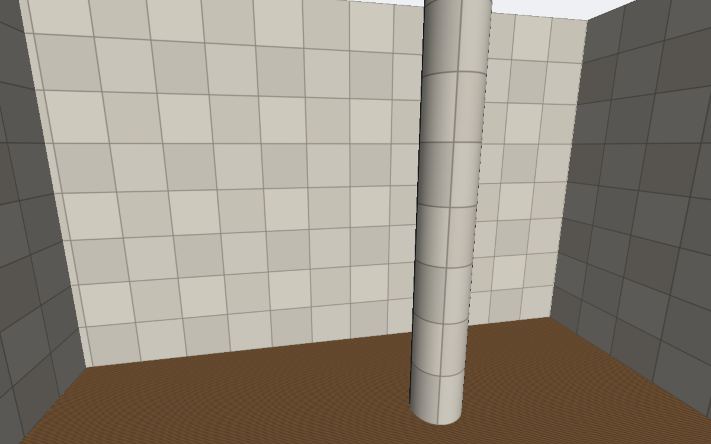
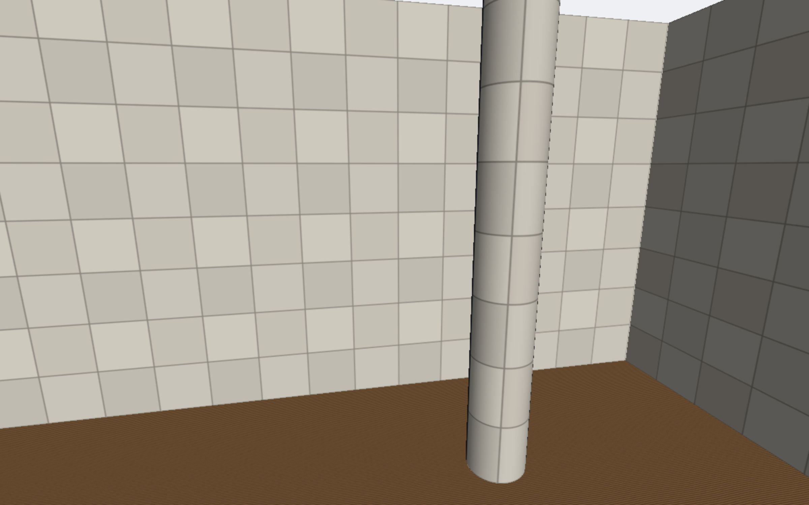
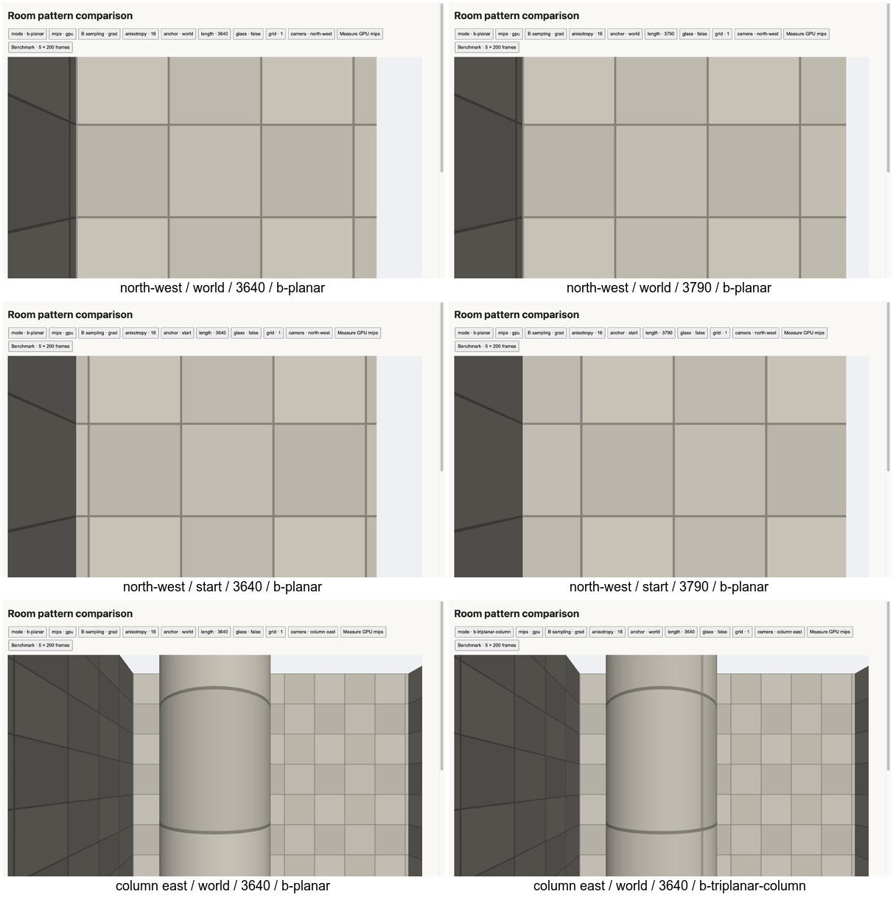
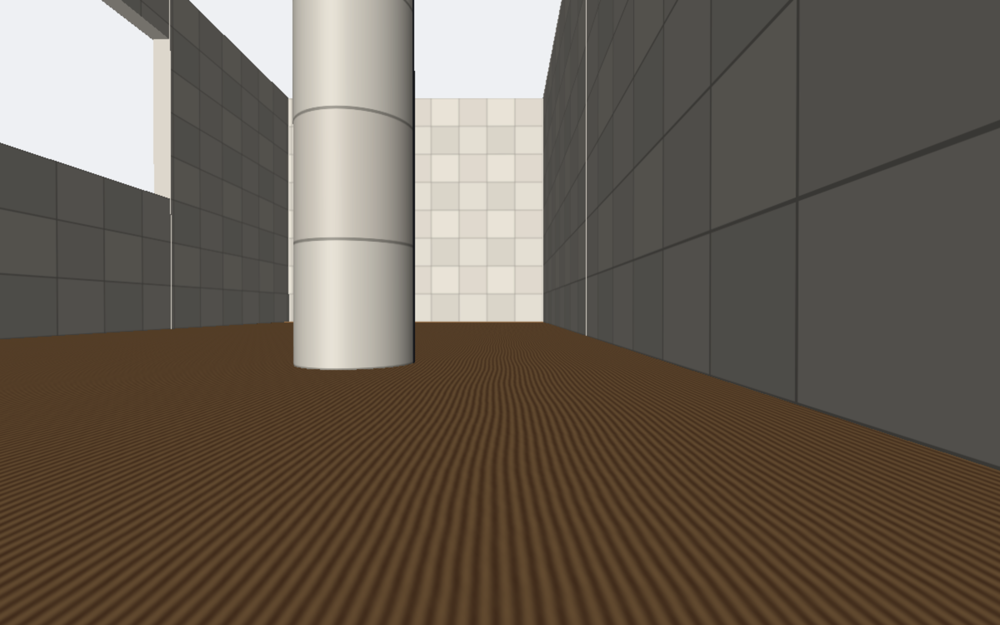

# 検証10：木目・タイルの柄を描く経路と、柄の座標の決め方

実施日：2026-11-26。Issue #173。木目の床とタイルの壁を持つ箱の部屋を、二つの描画の経路で試作し、WebGPUを使えるChromium（T3のプレビュー）で描いて比べた。採った方式は次のとおりで、計画の4.8に書いた。

- 柄は、SolidCraftのviewport-gpuが不透明な面を描くときに、面の基本色を柄の画像の色に置き換えて描く（案B）。ビューアが柄の面だけを自前のパイプラインで重ねる案Aは採らない。
- 柄の座標は、面ごとの平面投影（原点と、一回の繰り返しを表す二つのベクトル）で決め、シェーダーが世界座標から求める。壁の投影は、面の法線と、世界の原点から面の平面へ下ろした足で決め、壁の端点を使わない。
- 法線のそろわない面は三面投影とする。
- ミップマップは、表示する側がGPUで作る。
- 表示用の柄はContainerで作り、ブラウザが復号したRGBAをWasmへ渡す。

## 対象と測り方

試作は、使い捨てのコードとして `crates/viewer` の機能 `pattern-proto`・`pattern-a`・`pattern-b` と、viewport-gpuの機能 `pattern-maps` の下に置いた。機能を付けないビルドは、試作の前と同じバイト列のWasmになる。試作のコードは [prototype.patch](evidence/verification-10/prototype.patch)（`eea8ee48c` から `7e8a02037` までの差分）に残し、このブランチには含めない。

| 案 | 描き方 |
| --- | --- |
| A | `crates/viewer` が柄の面だけの頂点バッファと自前のWGSLを持ち、`Renderer::paint` の後に同じ描画パスで、深度を書かずに `GreaterEqual`（逆向きの深度）で重ねる。照明はviewport-gpuの `sky = 0` の式を写した。柄の座標は、面ごとの投影からシェーダーで求める方式と、CPUで頂点ごとに求めて渡す方式の二つ |
| B | viewport-gpuの `capture.rs` に `scene_geometry_mapped` を足し、柄を持つ面にパレットの項目を別に割り当てる。項目ごとの柄の層と投影をテクスチャの行で渡し、`solid()` の初めで世界座標から柄の座標と微分を求め、柄の面でだけ `textureSampleGrad` で標本を取って基本色を置き換える。三角形の頂点（32バイト）は変えない |

場面は、内法3,640×2,730 mm、壁の厚さ120 mm、高さ2,400 mmの部屋である。

- 床の上面は、SolidCraftの素材集のオークの木目（`SURF-027`、512×512、240×480 mmの繰り返し、MIT OR Apache-2.0）を使った。
- 壁の内側の面は、ページで作った300 mm角のタイル（色の違う4枚で600 mmの繰り返し）を使った。
- 南の壁は x = 1,820 mm で二つのボディに分けた。北の壁は窓の開口の周りの壁で作り、開口に不透明度0.35のガラスを入れられる。
- 部屋の中に、半径150 mmの円柱を置いた。
- 東の壁を動かして、内法の長さを3,640、3,790、5,460 mmに変えられる。部屋を8×8に並べて重くもできる。

壁の投影の原点には、二つの決め方を用意した。境界は上から見て反時計回りに向く。

| 決め方 | 原点 |
| --- | --- |
| 世界 | 世界の原点から壁の線へ下ろした足（階の基準高さ） |
| 始点 | 境界の始点 |

試作の投影の向きは、計画に書いた向きと違う。試作の壁はuを境界の向き、vを+zとし、床はuを+y（240 mm）、vを+x（480 mm）とした。壁の画像は計画の向きから180°回り、床は木目がx方向に通る。計画の向き（u = t×n、v = −t）では描いていない。投影が面の平面だけで決まることと、原点の決め方の比較は、向きによらない。

計測は、Apple M4 Pro（論理CPU 12、メモリ24 GiB）、macOS 27.2.1、T3 CodeのChromium 152（WebGPU）、Rust 1.99.1、wgpu 30で行った。マシンはほかの担当のビルドと共有しており、負荷平均は計測によって7.6から56だった。フレームの時間は、1920×1200の画面外の描画先へ、`Renderer::prepare`・`paint` と柄の描画を毎フレーム行い、カメラをわずかに揺らしてviewport-gpuの絵の再利用を避け、200フレームの後に `onSubmittedWorkDone` を待った経過時間をフレーム数で割った値である。50フレームの暖機の後、各条件を5回以上測った。

画素の比較と、復号とミップマップの時間は、[probes.js](evidence/verification-10/probes.js) を試作のページで実行して求め、出力を [probes.json](evidence/verification-10/probes.json) に残した。画面は1200×750画素で、RGBの差の合計が6（765のうち）を超える画素を「変わった画素」と数えた。

## 結果

### ガラスを入れたときの遮蔽

| 案 | ガラスなし | ガラスあり |
| --- | --- | --- |
| A | 正しい | 崩れる。奥の部屋の柄が手前の北の壁の上に描かれ、1室でも円柱の底の面が床の上に見えた |
| B | 正しい | 正しい |

窓越しに見た床（画面の中央の5×5画素の平均）は、Bではガラスを入れると (140,105,63) から (130,137,127) に変わり、ガラスの色が掛かった。Aでは (140,106,63) のまま変わらなかった。

ガラスがあると、viewport-gpuは順序に依存しない透明の合成のために、一枚の絵を画面の外で描き、ビューアの描画先へは色だけを写す（`view.rs` の `see_through` と `ss_ready`）。ビューアの深度バッファは遠い値のまま残るので、Aの柄の面はどこでも深度の検査を通る。今のmodelingは透ける面を作らないが（3.5）、ガラスや半透明の階、`ssaa ≠ 1` のどれでも同じことが起きる。

8×8室、北の窓へ向けた視点、ガラスあり。左が案A、右が案B。




### 壁を伸ばしたとき、分けたとき

Bの世界の決め方で、同じ視点から内法を3,640 mmと5,460 mmにして画素を比べた。画面を幅100画素の帯に分けると、東の壁が映る左の2本の帯だけが変わり、ほかの10本の帯で変わった画素は、75,000画素のうち0〜2画素だった。南の壁を分ける位置も x = 1,820 mmから2,730 mmへ動いたが、この範囲は変わらなかった。柄は伸ばしても大きさが変わらず、分けた壁の間でつながる。左が3,640 mm、右が5,460 mmである。




北の壁の西の端を世界に固定した視点から見て、内法を3,640 mmから3,790 mm（タイルの半分の150 mm）に伸ばした。

| 決め方 | 変わった画素（900,000画素中） | 帯ごとの変わった画素 |
| --- | ---: | --- |
| 世界 | 48,776 | タイルの帯は0。窓の開口が75 mm動いた右の2本の帯だけ |
| 始点 | 385,965 | タイルの帯で最大73,309。目地が半タイルずれた |

北の壁の始点は、伸ばすと動く東の端にある。始点の決め方では、壁の端が動くたびに柄が滑る。次の画像の上の段は世界の決め方、中の段は始点の決め方で、左が3,640 mm、右が3,790 mmである。下の段は次の節の円柱である。



### 柄の座標の持ち方

案Aの二つの方式は、北の窓へ向けた画面で、少しでも違う画素が900,000画素のうち368画素、変わった画素は0、RMSEは0.000047だった。平面の面では同じ絵になる。1室の柄の面10面で、投影の情報は面ごとに36バイト（Aの描画の値の整列を含めて48バイト）で計360バイト、頂点ごとの座標は342頂点で2,736バイトだった。試作のBは、パレットの幅（2,048項目）の行の単位で表を確保するので、10面でも98,304バイトのテクスチャを使った。

同じ絵になるのは、世界座標の誤差が小さいときに限る。表示データの位置はf32なので、柄の座標の精度は位置の精度に従う。300 mmの繰り返しを1024画素で描くときの柄の座標の誤差を、f32の計算を写したスクリプトで求めると、原点を住宅の近くへ寄せた場合で、世界の原点から100 mでは0.013画素、1 kmでは0.10画素、住宅データが許す10 kmでは1.7画素だった。頂点ごとにf64で求めた座標は、どこでも0.001画素だった（[precision-sweep.out](evidence/verification-10/interrogate/precision-sweep.out)）。

### 円柱の面

平面投影（y方向への投影）では、円柱の東と西の面で柄が横に伸び、縦の目地が消えた。三面投影では縦の目地が現れた。同じ視点の二枚の画像で、変わった画素は200,537だった。試作の三面投影は、世界のx・y・zの軸に沿い、どの軸の繰り返しも|u|とした。計画に書いた、投影のu・v・wの軸に沿う三面投影では描いていない。

### 描画の時間

同じ条件の連続した計測で、1920×1200、8×8室、ガラスなし、ミップマップあり、異方性16のときの値である（`7e8a02037` の各ビルド、各5回の中央値と範囲、ms/フレーム、負荷平均17〜21）。値は [bench-parent.json](evidence/verification-10/bench-parent.json) にある。

| ビルドとモード | 中央値 | 範囲 |
| --- | ---: | --- |
| 柄の機能なし、単色 | 0.192 | 0.189〜0.229 |
| B、単色（柄の面なし） | 0.383 | 0.382〜0.385 |
| B、平面投影 | 0.420 | 0.420〜0.421 |

柄の標本そのものは約0.04 msで、残りの約0.19 msは、試作のシェーダーが柄のない画素でも投影の表を読み、微分を求める処理である。二回目の計測（下）の担当は、記録していない一時的な変更で描画面積を4分の1にし、Bの時間が0.411から0.127 msに下がったと報告した（[bench-sampling.json](evidence/verification-10/bench-sampling.json) の `scissorProbe`）。異方性を16から1にしても変わらなかった。画素ごとの処理が制約で、柄の面だけで表を読めば減らせると推定する。60 Hzの一フレーム（16.7 ms）に対して、試作のBの増分は2%未満である。

条件を変えた計測は、負荷平均45〜56のときに二回に分けて行った。単色は、どちらの回も柄の機能のないビルドで測った。値はms/フレームの中央値で、各回の値と範囲は [bench-modes.json](evidence/verification-10/bench-modes.json) と [bench-sampling.json](evidence/verification-10/bench-sampling.json) にある。

一回目は、案Aと案Bを比べた。案Aは柄の面ごとに描画を一回足すので、8×8室では640回の描画になり、ガラスなしで単色より約0.1 ms長かった。案Bはこの回、すべての画素で3回の標本を取る形だった。

| モード | 1室 | 1室・ガラス | 8×8室 | 8×8室・ガラス |
| --- | ---: | ---: | ---: | ---: |
| 単色 | 0.216 | 0.364 | 0.214 | 0.325 |
| A、平面投影 | 0.264 | 0.410 | 0.314 | 0.402 |
| A、頂点ごとの座標 | 0.257 | 0.405 | 0.281 | 0.393 |
| B、平面投影（すべての画素で3回の標本） | 0.530 | 0.704 | 0.522 | 0.666 |

二回目は、案Bの標本の取り方を比べた。柄の面だけで標本を取る形は、すべての画素で3回取る形より0.20〜0.22 ms短く、単色より0.26〜0.30 ms長かった。三面投影の円柱と平面投影の差は、測定の範囲が重なった。

| モード | 1室 | 1室・ガラス | 8×8室 | 8×8室・ガラス |
| --- | ---: | ---: | ---: | ---: |
| 単色 | 0.213 | 0.351 | 0.218 | 0.339 |
| B、平面投影（柄の面だけ1回の標本） | 0.503 | 0.650 | 0.482 | 0.631 |
| B、平面投影（すべての画素で3回の標本） | 0.721 | 0.861 | 0.681 | 0.846 |
| B、円柱だけ三面投影 | 0.559 | 0.683 | 0.520 | 0.673 |

### Wasmのサイズ

`7e8a02037` の試作をreleaseでビルドし、wasm-bindgenの後の `_bg.wasm` を測った（バイト、[wasm-sizes.txt](evidence/verification-10/wasm-sizes.txt)）。

| ビルド | wasm-bindgenの前 | `_bg.wasm` | gzip -9 | Brotli -q 11 |
| --- | ---: | ---: | ---: | ---: |
| 試作なし | 2,283,939 | 1,180,745 | 335,988 | 239,387 |
| 試作の場面と計測だけ | 2,321,221 | 1,215,965 | 343,498 | 245,088 |
| 案A | 2,352,481 | 1,250,841 | 354,872 | 253,755 |
| 案B | 2,389,247 | 1,282,558 | 359,452 | 256,540 |

場面と計測だけのビルドからの増分は、案Aが34,876バイト（Brotliで8,667バイト）、案Bが66,593バイト（同11,452バイト）だった。`scripts/check/check-viewer-wasm.ts` でクレートごとのコードを比べると（`wasm-crates-*.txt`）、案Bの増分44,906バイトのうち、viewport-gpuの関数は6,616バイトで、js-sys（12,914バイト）とcore（11,882バイト）の多くは、GPUのミップマップの時間を測り読み戻すための試作のコードである。案Bの増分は上の値より小さくなる見込みである。

upstreamの変更は、既存のファイル（`capture.rs`・`view.rs`・`lib.rs`・`Cargo.toml`）で約90行と、新しい `maps.rs` である。`maps.rs` は、柄の表と層を受け持つ部分が158行（`5dd6d3389`）で、GPUのミップマップと計測を足して266行になった。シェーダーは機能の下で切り替えるために写しのファイルを作り、そこに40行を足した。

### ミップマップと画像の復号

| 1層の大きさ | CPUで作る（Wasm、5回の中央値） | GPUで作る（記録から完了まで） | タイルのレベル4の最大差 |
| --- | ---: | ---: | ---: |
| 512×512 | 7.3 ms | 0.7 ms | 0 / 255 |
| 1024×1024 | 29 ms | 0.7 ms | 0 / 255 |

値は `probes.json` による。GPUの時間は `performance.now` の0.1 msの刻みで測った。二回目の計測の担当の値は0.51 msと0.54 msだった（`bench-sampling.json`）。GPUで作るときは、レベル0を書き込んだ後、各レベルを一つ上のレベルから描画で縮小した。`Rgba8UnormSrgb` の形式で読み書きするので、平均は線形の光で取られ、CPUで線形の光で平均した結果と一致した。CPUで作ると1024×1024の一枚でブラウザの主スレッドを約30 ms止めるので、GPUで作る。ミップマップのない画面では、遠くの床に波の模様が出た（左がミップマップなし、右がGPUで作ったミップマップ）。




ページで作った1024×1024のJPEG（128,528バイト）を、ブラウザの `createImageBitmap` とキャンバスの `getImageData` でRGBAにする時間は、初回3.7 ms、二回目から5回の中央値3.0 ms（3.0〜3.2 ms）だった。Chromiumは、`imageOrientation` を `none` にしてもEXIFの向きを当てた（[exif-probe.out](evidence/verification-10/interrogate/exif-probe.out)）。表示用の柄は向きの情報を持たない画像にする。

## 決め手

**Bを採る。** Aは、ガラスや半透明の面、`ssaa ≠ 1` のどれかでviewport-gpuが画面外の描画に切り替わると、深度を失って柄が手前の面の上に出る。直すには、viewport-gpuの深度を外へ出す変更か、ガラスまでビューアが描く変更が要り、upstreamを変えないというAの利点が消える。Aは柄の面を二度描き、照明の式を写して保ち、後の日差しの影も自分で描くことになる。Bは、柄の面を既存の不透明な面の描画に載せるので、ガラス越しの合成、AO、後の影の項がそのまま当たる。upstreamの変更は既存のファイルで約90行と一つの新しいファイルで、機能を有効にしない限り絵もWasmも変わらない。

**柄の座標は平面投影とし、頂点ごとの座標は持たない。** 住宅が世界の原点の近くにあれば、平面の面では同じ絵になり、表示データは面ごとの小さな投影で済む。Bで頂点ごとの座標を持つには、三角形の頂点の形式を広げ、viewport-gpuとSolidCraftの画面のコードの多くを変える必要がある。原点から遠い住宅で柄の座標が粗くなるのは、表示データの位置がf32だからで、形も同じく粗くなる。

**壁の投影は、面の法線と世界に固定した原点で決める。** 端点や境界の向きを使うと、伸ばした壁で柄が滑り、分割・統合で向きが反転しうる。画像の行は下へ進むので、vの向きを下向きにし、どの面でも画像が裏返らないようにした（[orientation-rule.out](evidence/verification-10/interrogate/orientation-rule.out)）。

**ミップマップはGPUで作る。** CPUと同じ結果で、時間は1 ms未満だった。保存した柄にミップマップを含める方式は、取得するバイト数が増え、JPEGで小さいレベルが崩れる。

## 設計の比べ方

試作と並行して、二つのOpus（effort medium）が、経路、座標の規則、表示データの形、ミップマップ、画像の流れ、日差しの影を、互いに独立に設計した。判定役は別の系統のGrok 4.7（effort xhigh）が務め、六つの観点で採点した。二つの案は、Bを採る、パレットの項目で柄を引く、壁の投影を面の法線と世界の原点で決める、Containerで表示用の柄を作る、ブラウザで復号する、の点で一致した。判定役は案1（25点、案2は21点）を土台に推し、担当も同じ案を選んだ。

案2から取り込んだのは、原点を住宅の中心の近くへ繰り返しの整数倍だけ寄せること、柄の識別子に元の資産のSHA-256を使うことである。判定役は、メッシュから描画データを作る経路を `scene_geometry` の一つに保つことも推した。案2の、ミップマップを含めたJPEGを保存する方式は採らなかった。判定役は、SolidCraftのシェーダーの検査が `textureSampleGrad(` も微分として数えると指摘したが、誤りだった（次の節の1）。

二つの案、判定の基準、共通の資料は [evidence/verification-10/design/](evidence/verification-10/design/) にある。

## 反対役の試し

計画と記録の初めの版を、二つのOpus（effort high）の反対役に壊させた。共有のディスクが足りなかったので、作業ツリーを分けず、反対役はリポジトリを読むだけにし、自分のフォルダーのスクリプトと、動いている試作のページで試した。担当がそれぞれの結果を実行し直し、次を確かめて直した。どちらの反対役も、ベンチマークの中央値と範囲、Wasmのサイズ、ガラスでのAの崩れとBの正しさ、世界の決め方で柄が動かないことは、記録のとおりに再現した。

1. **シェーダーの検査の記述が誤っていた（二人とも）。** 検査が探す文字列 `textureSample(` は `textureSampleGrad(` に含まれない（`node -e 'console.log("textureSampleGrad(".includes("textureSample("))'` は `false`）。試作のシェーダーは分岐の後で `textureSampleGrad` を呼び、検査を写したスクリプトを通った。計画から「分岐の前で取るか、検査を変えるか」という決めごとを消した。
2. **向きの規則で画像が裏返っていた（二人とも）。** 初めの版は、壁のvを+z、床のvを+yとしていたが、画像の行は下へ進むので、どの面でも鏡に映った絵になり、壁では上下も逆になる（[handedness.out](evidence/verification-10/interrogate/handedness.out)）。規則を u = t×n、v = −t に直し、どの面でも裏返らないことを確かめた。試作が描いた向きは計画と違うことを、この記録に書いた。
3. **原点から遠いと柄の座標が粗くなる（反対役1）。** 原点を寄せても、f32の位置そのものが粗いので、10 kmでは1.7画素の誤差になる。計画に精度の範囲を書いた。
4. **三面投影の軸が決まっていなかった（二人とも）。** 計画の三面投影の第三の軸の長さが書かれておらず、試作は世界の軸で描いていた。計画にwの軸を定め、試作が描いた形をこの記録に書いた。
5. **ブラウザはEXIFの向きを必ず当てる（反対役1）。** 計画は「向きを変換しない」としていた。Containerが向きの情報を持たない画像を返すことにした。
6. **記録の値に証拠のファイルがなかった（二人とも）。** 画素の比較、復号の時間、CPUのミップマップの時間を `probes.js` で測り直し、出力を `probes.json` に残して、値を差し替えた。描画面積を4分の1にした計測は、記録していない変更によることを書いた。
7. **再実行の手順でベンチマークが動かなかった（反対役2）。** ページのベンチマークは `proto` と `b` のビルドも読むが、手順は `all` だけを作っていた。また、配っていた `proto` と `b` は前のコミットのもので、部屋の長さの渡し方が違った。手順を五つのビルドに直し、同じコミットのビルドで測り直した。
8. **upstreamの変更の量を少なく書いていた（二人とも）。** `maps.rs` の行数とシェーダーの行数を直した。
9. **480バイトはBの表の大きさではなかった（反対役2）。** 試作のBの表は98,304バイトであることを書いた。
10. **計画のほかの節と食い違っていた（反対役2）。** 4.7の「表示データ以外の応答はJSON」を、表示用の柄の画像も除くように直した。modelingは透ける面を作らない（3.5）ので、6.4の完了条件から、透けるボディがあるときの遮蔽を外した。
11. **変わった画素の数え方を書いていなかった（反対役2）。** 閾値を書いた。

## 残る課題

- 計測は一台のMacとChromiumだけで行った。SafariとFirefoxのWebGPU、性能の低いGPUでは確かめていない。
- フレームの時間は、ほかの担当のビルドと共有するマシンで測った。比べたのは、同じ呼び出しの中で交互に測った値と、続けて測った値だけである。
- 計画の向き（u = t×n、v = −t）と、u・v・wの軸に沿う三面投影は、試作で描いていない。
- 試作のBは、柄のない画素でも投影の表を読む。柄の面だけで読む形で時間が下がるかは確かめていない。
- 表示データの位置はf32の世界座標なので、原点から遠い住宅では形も柄も粗くなる。住宅の近くを原点にした位置で表示データを書くかは決めていない。
- 写真から作った表示用の柄と、その復号の時間は確かめていない。復号はページで作った画像で測った。
- テクスチャ配列の層の数とGPUのメモリの上限は決めていない（1024×1024の層はミップマップを含めて約5.6 MB）。
- 開口の見込みの面と天井の柄は試していない。

## 再実行と証拠

証拠は [evidence/verification-10/](evidence/verification-10/) にある。

- `prototype.patch` は、`eea8ee48c` から `7e8a02037` までの試作のコードの差分である。
- `probes.js` と `probes.json` は、画素の比較、復号、ミップマップの時間である。
- `bench-modes.json`、`bench-sampling.json`、`bench-parent.json` は、フレームの時間の各回の値である。
- `wasm-sizes.txt` と `wasm-crates-*.txt` は、Wasmのサイズとクレートごとのコードである。
- `interrogate/` に、反対役の試しのうち、記録が引くスクリプトと出力がある。
- `design/` に、設計の課題、二つの案、判定の基準、試作の前に読んだ資料の要約がある。

再実行するときは、基準のコミットのworktreeを作り、差分を当ててWasmをビルドし、リポジトリのルートを静的なサーバーで配る。

```sh
git worktree add --detach ../v10-rerun eea8ee48c
cd ../v10-rerun
git checkout origin/main -- docs/verification/evidence/verification-10
git apply docs/verification/evidence/verification-10/prototype.patch
mise exec -- pnpm install --frozen-lockfile
mise exec -- pnpm setup
for v in base proto a b all; do bash crates/viewer/proto/build.sh "$v"; done
python3 -m http.server --bind 127.0.0.1 8000
```

WebGPUを使えるChromiumで `http://127.0.0.1:8000/crates/viewer/proto/index.html?pkg=all` を開き、ボタンで案、ミップマップ、標本の取り方、異方性、投影の決め方、部屋の長さ、ガラス、部屋の数、視点を切り替える。ページが準備できたら、開発者ツールのコンソールで `await (await import("/docs/verification/evidence/verification-10/probes.js")).run()` を実行すると、`probes.json` の値を出す。`build.sh` はビルドごとにサイズを表示する。SolidCraftをネイティブにビルドすると数GBを使うので、試作はWasmのビルドだけで確かめた。
